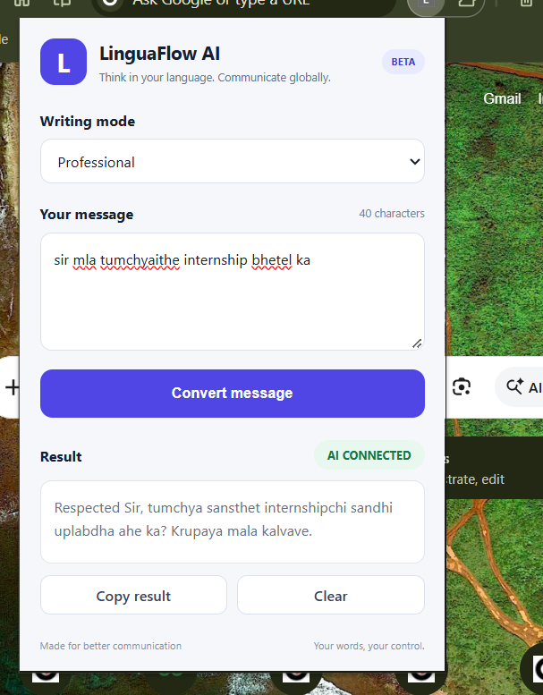
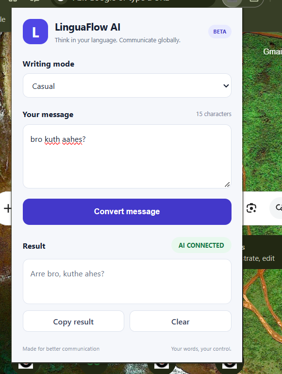
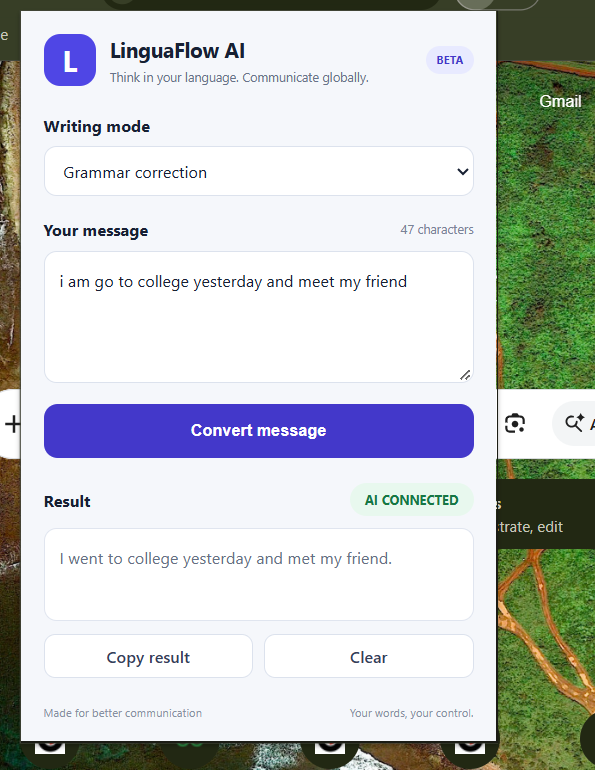

# LinguaFlow AI

**Write naturally. Communicate globally.**

LinguaFlow AI is a Chrome extension that helps users rewrite messages in different writing styles. It uses a Chrome extension frontend, a FastAPI backend, and Google's Gemini API to transform text while preserving the original meaning.

## Features

- **Professional mode** — Rewrite messages in a polished, professional tone.
- **Casual mode** — Make messages sound friendly and natural.
- **Grammar correction** — Correct grammar, spelling, and punctuation.
- **Character counter** — Track the length of your message.
- **Copy result** — Copy the generated text.
- **Clear input** — Reset the message and result.
- **AI status indicator** — Display the current conversion status.
- **Multilingual input** — Designed for messages in English, Marathi, and Hinglish; output quality may vary by language.

## Screenshots

### Professional Mode
Rewrite messages into a polite, professional tone.



### Casual Mode
Make messages sound friendly and natural.



### Grammar Correction
Correct grammar while preserving the original meaning.




## Technology Stack

| Component | Technology |
|---|---|
| Browser extension | Chrome Extension Manifest V3 |
| Frontend | HTML, CSS, JavaScript |
| Backend | Python, FastAPI |
| AI integration | Google Gemini API |
| API server | Uvicorn |
| Version control | Git and GitHub |

## Architecture

1. The user enters a message in the Chrome extension.
2. The extension sends the message and selected writing mode to the FastAPI backend.
3. The backend builds instructions for the selected mode.
4. The backend sends the request to the Gemini API.
5. The generated response is returned to the extension and displayed to the user.

## Project Structure

```text
LinguaFlow-AI/
├── backend/
│   ├── main.py
│   ├── requirements.txt
│   └── .env
├── popup/
│   ├── popup.html
│   ├── popup.css
│   └── popup.js
├── manifest.json
├── .gitignore
└── README.md
```

The `.env` file is local configuration and must not be committed. It should be created locally during setup.

## Getting Started

### Prerequisites

- Google Chrome
- Python 3.10 or later, compatible with the installed dependencies
- A Gemini API key
- Git

### 1. Clone the repository

```bash
git clone <YOUR_GITHUB_REPOSITORY_URL>
cd LinguaFlow-AI
```

Replace the placeholder URL with your repository URL.

### 2. Set up the backend

```bash
cd backend
python -m venv .venv
```

Activate the virtual environment on Windows:

```powershell
.venv\Scripts\Activate.ps1
```

Install dependencies:

```bash
pip install -r requirements.txt
```

### 3. Configure the Gemini API key

Create a file named `.env` inside `backend/`:

```env
GEMINI_API_KEY=YOUR_GEMINI_API_KEY_HERE
```

Replace the placeholder with your own API key. Never commit or share this secret.

### 4. Start the backend

From the `backend` directory, run:

```bash
python -m uvicorn main:app --reload
```

The API should be available at:

- API root: `http://127.0.0.1:8000/`
- Health check: `http://127.0.0.1:8000/health`
- Interactive API documentation: `http://127.0.0.1:8000/docs`

Keep the backend running while using the local extension.

### 5. Load the Chrome extension

1. Open `chrome://extensions` in Chrome.
2. Enable **Developer mode**.
3. Click **Load unpacked**.
4. Select the project root folder containing `manifest.json`.
5. Open the LinguaFlow AI extension and test a message.

## API Endpoint

### `POST /api/convert`

Example request:

```json
{
  "text": "i am go to college yesterday and meet my friend",
  "mode": "grammar"
}
```

Supported modes:

- `professional`
- `casual`
- `grammar`

A successful response contains the status, selected mode, and generated result.

## Security Notes

- Keep your Gemini API key in `backend/.env`.
- Never commit `.env`, virtual environments, or other secrets.
- Restrict API usage and protect the backend before public deployment.
- The local development setup uses `127.0.0.1`; it is not a public production service.

## Current Status

The local prototype has been tested with all three writing modes using the Gemini-backed API.

## Future Improvements

- Improve multilingual output consistency.
- Add automated tests and stronger input validation.
- Add request limits and production-grade error handling.
- Deploy the backend securely.
- Add screenshots, a demo, and installation guidance for end users.

## License

A license has not yet been selected. Add a license before granting public reuse rights.
